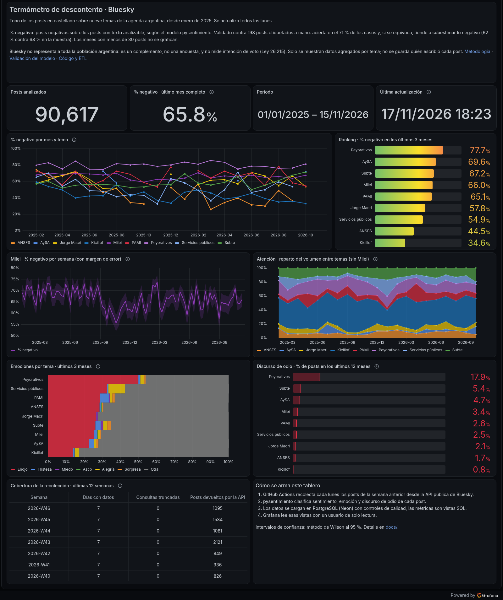

# opinion-publica-nlp — Termómetro de descontento

> **[Caso de estudio: el proyecto explicado en 2 minutos](https://scheffan.github.io/opinion-publica-nlp/)** (español / English)

De qué se queja la gente, dónde y con qué tono, a partir de fuentes públicas, legales y gratuitas.

**[📊 Ver el tablero en vivo](https://scheffan.grafana.net/public-dashboards/e2b286e8ee764c23b39a9b58cb62583c)**



## Para qué sirve

Un "termómetro de descontento" que mide de qué se queja la gente y con qué tono, tema por tema y semana a semana.
Sirve, por ejemplo, para que un municipio vea qué servicios generan más enojo, o para que una empresa de servicios
(AySA, Edesur…) siga cómo se habla de ella en redes y cruce eso con los reclamos formales.

**Hallazgos de la primera fuente (Bluesky, ene-2025 a nov-2026, 90.617 posts):**
- Dos de cada tres posts sobre estos temas son negativos; la emoción dominante es el enojo en todos.
- En los últimos tres meses, sin contar el indicador de insultos partidarios, los temas con más negatividad son AySA (70 %) y el subte (67 %), por encima de Milei (66 %).
- Milei concentra entre el 80 y el 90 % de la conversación; el resto de los temas se lee mejor por mes.
- El modelo de sentimiento se validó contra 198 posts etiquetados a mano (71 % de acierto) y se comparó con un modelo de lenguaje (79 %).

**Stack:** Python · pandas · pysentimiento (NLP en castellano) · PostgreSQL (Neon) · SQL · GitHub Actions · Grafana

## Fuente

| Fuente | Qué aporta | Estado |
|---|---|---|
| Bluesky (API pública de búsqueda) | Texto libre: sentimiento, emociones y discurso de odio por tema | ✅ Recolección semanal desde ene-2025, análisis validado y [tablero](https://scheffan.grafana.net/public-dashboards/e2b286e8ee764c23b39a9b58cb62583c) |

El plan original sumaba reclamos formales (Defensa del Consumidor y reclamos 147 de CABA) para cruzarlos con el tono en redes.
Los datos abiertos de denuncias por empresa estaban desactualizados (el último corte es de 2022–2023), así que quedaron fuera del alcance. Ver [Decisiones](docs/decisiones.md).

## Cómo funciona

```
API de Bluesky ──► Parquet crudo ──► análisis de texto ──► PostgreSQL ──► Grafana (link público)
   (lunes)          (en el repo)      (pysentimiento)      (modelo estrella + vistas, usuario de solo lectura)
```

Todo corre solo en GitHub Actions: recolección los lunes, análisis y carga a continuación,
y en cada push tests de código, tests de datos y una carga completa en un PostgreSQL de prueba.

## Documentación

| Documento | Contenido |
|---|---|
| [Caso de estudio](https://scheffan.github.io/opinion-publica-nlp/) | El proyecto explicado para no técnicos, con ejemplos y validación (código en [`site/`](site/)) |
| [Arquitectura](docs/arquitectura.md) | Capas, flujo y automatización |
| [ETL paso a paso](docs/etl.md) | Extracción, limpieza, análisis y carga |
| [Modelo de datos](docs/modelo-de-datos.md) | Diagrama de tablas, diccionario de datos y vistas |
| [Metodología](docs/metodologia.md) | Sesgos, métricas e intervalos de confianza |
| [Calidad de datos](docs/calidad-de-datos.md) | Tests y controles |
| [Validación del modelo](docs/validacion.md) | Comparación con 198 posts etiquetados a mano |
| [Decisiones](docs/decisiones.md) | Qué se eligió, qué se descartó y por qué |

## Uso rápido

```bash
pip install -e ".[dev]"
python scripts/recolectar_bluesky.py --semana-anterior
DATABASE_URL=postgresql://... python scripts/cargar_bd.py
pytest
```

Para el análisis de texto ver [docs/etl.md](docs/etl.md#cómo-correr-todo-en-local).

## Privacidad

- No se guardan handles, DIDs, nombres ni la URI del post. El id es un hash de la URI y sirve solo para evitar duplicados.
- Las menciones y los enlaces a perfiles dentro del texto se enmascaran.
- Los resultados se publican solo agregados por tema; no se perfila a ninguna persona.

## Alcance

Bluesky no representa a toda la población argentina: es un complemento, no una encuesta.
El proyecto no mide intención de voto (Ley 26.215). Más detalle en [Metodología](docs/metodologia.md).
