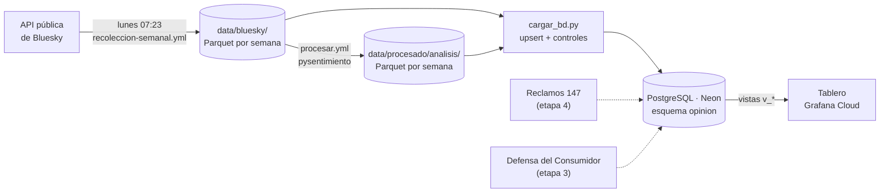

# Arquitectura

El proyecto sigue un esquema de tres capas, común en equipos de datos:

| Capa | Dónde vive | Qué contiene | Se puede regenerar desde |
|---|---|---|---|
| **Cruda** | `data/bluesky/` (Parquet, en el repo) | Lo que devolvió la API, sin datos del autor | — (es la fuente) |
| **Procesada** | `data/procesado/` (Parquet, en el repo) | Análisis de texto de cada post | La capa cruda |
| **Analítica** | PostgreSQL en Neon, esquema `opinion` | Modelo estrella + vistas con las métricas | Las dos capas anteriores |

## Tablero

- Un tablero de Grafana por fuente. El de Bluesky está definido como código en
  [`grafana/generar_bluesky.py`](../grafana/generar_bluesky.py), que escribe `grafana/bluesky.json`
  (se importa en Grafana con *Dashboards → New → Import*).
- Grafana se conecta a Neon con el usuario **`grafana_lector`**, que solo puede leer las vistas del tablero
  ([`sql/03_permisos.sql`](../sql/03_permisos.sql)): no ve las tablas ni puede escribir. Tiene un límite de
  40 conexiones (alcanza para los tres tableros abiertos a la vez) y 30 segundos por consulta, para que el link público no pueda sobrecargar la base.
- El usuario se crea por SQL en cada carga (`cargar_bd.py`) con la contraseña del secreto `GRAFANA_DB_PASSWORD`.
  No se crea desde la consola de Neon porque ahí recibe permisos de administrador.

La base de datos no es la fuente de verdad: si se borra, se reconstruye entera con
`python scripts/cargar_bd.py`. Eso permite cambiar el esquema o las métricas sin miedo a perder datos.

## Flujo



## Automatización (GitHub Actions)

| Workflow | Cuándo corre | Qué hace |
|---|---|---|
| `recoleccion-semanal.yml` | Lunes 07:23 (hora argentina) | Trae la semana anterior de Bluesky |
| `procesar.yml` | Al terminar la recolección, o a mano | Analiza posts pendientes, guarda y carga la base |
| `historico.yml` | A mano, con fechas | Recolecta un rango de fechas pasado |
| `ci.yml` | En cada push | Tests de código, tests de datos y una carga completa en un PostgreSQL de prueba |

Todos los workflows que escriben datos comparten el grupo de concurrencia `datos`:
corren de a uno, así nunca hay dos procesos escribiendo el mismo archivo.

## Estructura del repo

```
config/            términos de búsqueda y temas
src/opinion_publica/
  bluesky.py       cliente de la API y ventanas de búsqueda
  almacen.py       privacidad y guardado por semana
  nlp.py           sentimiento, emoción y odio
  carga.py         carga a PostgreSQL
  controles.py     controles de calidad en la base
scripts/           puntos de entrada de cada paso
sql/               esquema y vistas (se aplican en cada carga)
data/              capas cruda y procesada
tests/             tests de código y de datos
docs/              esta documentación
```
