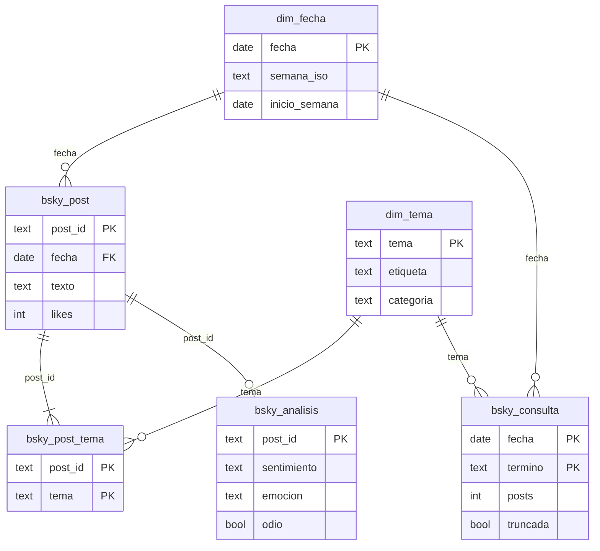

# Modelo de datos

Esquema `opinion` en PostgreSQL. Es un **modelo estrella**: dimensiones compartidas por
todas las fuentes (fecha y tema) y tablas de hechos por fuente. Definición completa en
[`sql/01_esquema.sql`](../sql/01_esquema.sql).

## Diccionario de datos

### `dim_fecha`: calendario
| Columna | Tipo | Descripción |
|---|---|---|
| `fecha` | date | Día (PK) |
| `anio`, `mes` | smallint | Año y mes calendario |
| `semana_iso` | text | Semana ISO, ej. `2026-W46` (de lunes a domingo) |
| `inicio_semana` | date | Lunes de esa semana |
| `dia_semana` | smallint | 1 = lunes … 7 = domingo |
| `es_fin_de_semana` | boolean | Sábado o domingo |

### `dim_tema`: temas de seguimiento
| Columna | Tipo | Descripción |
|---|---|---|
| `tema` | text | Clave (PK), ej. `aysa` |
| `etiqueta` | text | Nombre para mostrar, ej. `AySA` |
| `categoria` | text | `politica`, `transporte`, `estado`, `servicios`, `polarizacion` |

### `bsky_post`: un post de Bluesky
| Columna | Tipo | Descripción |
|---|---|---|
| `post_id` | text | Hash SHA-256 (20 caracteres) de la URI. No permite llegar al autor (PK) |
| `fecha` | date | Día argentino de la ventana de búsqueda donde apareció |
| `creado` | timestamptz | Fecha de creación declarada por el post |
| `texto` | text | Texto con menciones y perfiles enmascarados |
| `es_respuesta` | boolean | Si es respuesta a otro post |
| `likes`, `reposts`, `respuestas`, `citas` | integer | Interacciones al momento de recolectar |
| `recolectado` | timestamptz | Cuándo se recolectó |

### `bsky_post_tema`: temas de cada post (muchos a muchos)
| Columna | Tipo | Descripción |
|---|---|---|
| `post_id` | text | FK a `bsky_post` |
| `tema` | text | FK a `dim_tema` |

### `bsky_analisis`: análisis de texto (uno por post)
| Columna | Tipo | Descripción |
|---|---|---|
| `post_id` | text | FK a `bsky_post` (PK) |
| `modelo` | text | Versión del análisis, ej. `pysentimiento-0.7.3` |
| `texto_util` | boolean | `false` si el post no tiene texto analizable (solo link, emoji, etc.) |
| `sentimiento` | text | `positivo`, `neutro` o `negativo` (nulo si no es útil) |
| `p_positivo`, `p_neutro`, `p_negativo` | real | Probabilidades; suman 1 |
| `emocion` | text | `alegria`, `tristeza`, `enojo`, `miedo`, `asco`, `sorpresa`, `otra` |
| `p_alegria` … `p_otra` | real | Probabilidad de cada emoción; suman 1 |
| `odio` | boolean | El modelo detectó discurso de odio |
| `p_odio`, `p_agresivo`, `p_dirigido` | real | Probabilidades independientes (no suman 1) |
| `analizado` | timestamptz | Cuándo se analizó |

### `bsky_consulta`: registro de cada consulta a la API
| Columna | Tipo | Descripción |
|---|---|---|
| `fecha`, `termino` | date, text | Día y término consultado (PK) |
| `tema` | text | FK a `dim_tema` |
| `posts` | integer | Posts devueltos (antes de unir duplicados entre términos) |
| `ventanas` | integer | En cuántas ventanas hubo que partir el día |
| `truncada` | boolean | Alguna ventana de 1 hora siguió llena: puede faltar volumen |

### `etl_corrida`: bitácora del ETL
| Columna | Tipo | Descripción |
|---|---|---|
| `corrida_id` | bigint | PK autoincremental |
| `fuente`, `paso` | text | Ej. `bluesky`, `carga` |
| `inicio`, `fin` | timestamptz | Duración de la corrida |
| `estado` | text | `en_curso`, `ok` o `error` |
| `filas` | jsonb | Filas insertadas o actualizadas por tabla |
| `detalle` | text | Resultado de los controles o mensaje de error |
| `origen` | text | Link a la corrida de GitHub Actions |

## Vistas para el tablero

Toda la lógica de las métricas está en SQL ([`sql/02_vistas.sql`](../sql/02_vistas.sql)),
no en Grafana: cualquier número del tablero se puede reproducir con una consulta.

| Vista | Granularidad | Métricas |
|---|---|---|
| `v_bsky_semanal_tema` | semana × tema | posts, % del volumen, % negativo con intervalo de confianza, % positivo, % odio, `poca_muestra` |
| `v_bsky_mensual_tema` | mes × tema | lo mismo por mes, para temas con poco volumen semanal |
| `v_bsky_emociones_semanal` | semana × tema × emoción | posts y % de cada emoción |
| `v_bsky_cobertura` | semana | días con datos, consultas truncadas, posts reportados por la API |
| `v_semana_completa` | semana | semanas ya terminadas (las demás vistas filtran con esta) |

## Próximas fuentes (planificado)

| Tabla | Fuente | Granularidad | Por qué agregado |
|---|---|---|---|
| `dim_comuna` | BA Data | comuna (1 a 15) | Dimensión para el mapa |
| `suaci_reclamo_diario` | Reclamos 147 / BA Colaborativa | día × comuna × concepto | Son 16 años de reclamos: crudos no entran en 1 GB; agregados sí, y alcanzan para el mapa y las tendencias |
| `dim_empresa` | Defensa del Consumidor | empresa / rubro | Dimensión para cruzar con el tono en Bluesky |
| `consumo_denuncia_mensual` | Ventanilla Única Federal | mes × empresa × rubro × provincia | Ídem |

Los archivos completos de esas fuentes quedan en el repo (capa cruda) y en la base entra solo el agregado.
